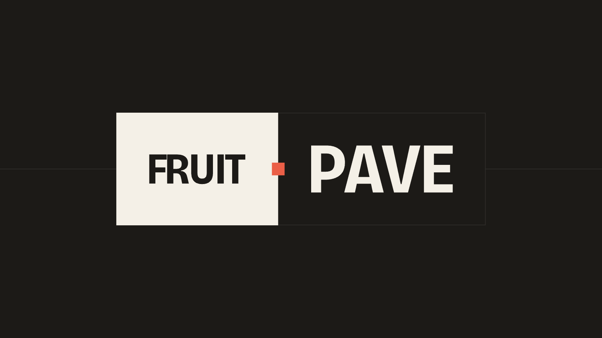

# PAVE

PAVE is a protocol for making human judgment callable by AI agents.

It enables AI and agentic systems to discover and consult representations of human judgment within an authorized scope, while preserving attribution, provenance, and the boundaries of human authority.

Developed by [FRUIT](https://byfruit.io), PAVE provides the protocol behind [Callable Human Judgment](https://byfruit.io/what-is-callable-human-judgment/).

## Why human judgment?

AI agents can retrieve information, evaluate options, and execute tasks. But the ability to act is not the same as the ability to exercise judgment.

Human judgment develops through experience. It shapes how people interpret incomplete information, weigh competing priorities, recognize exceptions, and determine when an action is appropriate.

A procurement expert may recognize when a lower price creates unacceptable delivery risk. An engineering leader may know which architectural compromise is worth making. A researcher may distinguish a promising result from a well-supported conclusion.

As AI agents take on more responsibility within organizations, human judgment needs a way to participate in automated workflows.

PAVE is designed to make that possible.

## How PAVE works

A **Lens** represents human judgment within a specific decision context, allowing authorized AI systems to consult that judgment when evaluating a situation.

In a PAVE-enabled workflow, an AI agent can:

1. Discover a relevant Lens.
2. Inspect its scope and permitted use.
3. Request its application to a decision.
4. Use the contribution to inform a recommendation.

For example, a procurement agent could consult a Lens informed by an expert's approach to supplier risk. The contribution would inform the recommendation, while purchasing authority remains with the organization.

Permission to consult a Lens is separate from permission to act. Cases outside its evaluated scope require fresh review. Consulting a Lens does not mean its source expert personally reviewed or approved that decision.

See [Architecture](architecture.md) for component responsibilities and workflow boundaries, and [Examples](examples.md) for proposed applications.

## Keeping people connected to automated work

PAVE is designed to make human judgment available across recurring decisions without requiring an expert to personally evaluate every instance.

Rather than treating human expertise solely as training material, PAVE provides a way for that expertise to remain identifiable, governed, and accessible during an AI system's operation.

People remain responsible for defining what is represented, evaluating its fidelity and limits, authorizing its use, and revising it as their experience develops. Direct human review remains essential for exceptions and decisions that require fresh judgment.

PAVE's intended model connects three elements:

- **Attribution:** Preserve the connection between a judgment contribution and its human source.
- **Authorization:** Define who may consult it, for which purposes, and under what conditions.
- **Economic participation:** Enable arrangements through which contributors can be compensated for authorized uses of their judgment.

The goal is to expand how people contribute to automated work while ensuring their judgment remains identifiable and its use governed.

## Documentation

| Document | What you'll find |
| --- | --- |
| [Architecture](architecture.md) | PAVE Core, PAVE Agent, and integration boundaries. |
| [Terminology](terminology.md) | Callable Human Judgment, GHI records, Lenses, and authority. |
| [Examples](examples.md) | Proposed procurement and creative-evaluation workflows. |
| [Licensing](licensing.md) | Public materials, private access, and contributor rights. |
| [Specification](spec/README.md) | Public architecture and access to detailed technical specifications. |
| [Publication history](history.md) | Previously published and retired materials. |

## Access and licensing

PAVE was invented by [Angela Benton](https://angelabenton.com). It is proprietary technology developed by [FRUIT](https://byfruit.io) and owned by **FRUIT Holdings, Inc.**

This repository contains public documentation. Access to PAVE specifications, implementations, and services requires a separate agreement with FRUIT.

Public repository materials are governed by the [PAVE Public Materials License](LICENSE). Rights in a contributor's source material and judgment records are separate and must be addressed in the applicable agreements.

To discuss evaluating, integrating, or licensing PAVE, contact [hello@byfruit.io](mailto:hello@byfruit.io).

For documentation feedback and technical questions, open a [GitHub issue](https://github.com/PAVE-Protocol/spec/issues).